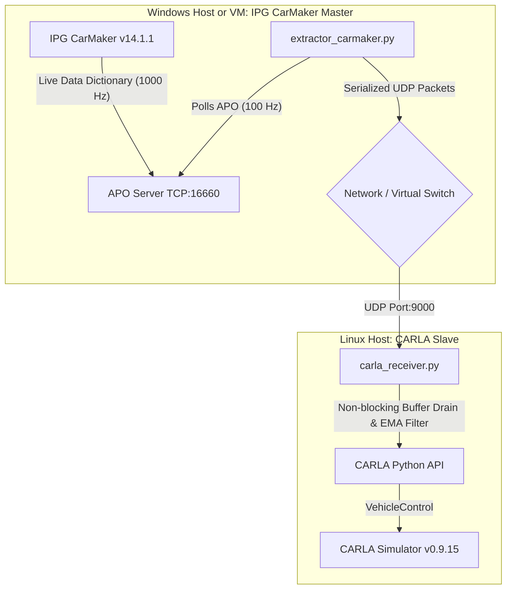

# Asynchronous SIL/HIL Simulation Bridge: IPG CarMaker ↔ CARLA Simulator

This repository contains a high-performance, Software-in-the-Loop (SIL) and Hardware-in-the-Loop (HIL) asynchronous simulation bridge. It is designed to inject high-fidelity vehicle dynamics and driver control inputs from an **IPG CarMaker** instance (running on Windows) into a **CARLA Simulator** instance (running on Linux).

> New to the repository? Read [HANDOFF.md](HANDOFF.md) for current state and [docs/README.md](docs/README.md) for the documentation map. 

---

## 1. Project Overview

In autonomous driving and vehicle dynamics validation, co-simulation combines the strengths of multiple platforms:
* **IPG CarMaker** provides industry-standard vehicle physics, detailed powertrain/chassis models, and hardware-in-the-loop (HIL) input hub interfaces (e.g., physical steering wheels and pedals).
* **CARLA Simulator** acts as the high-fidelity virtual sensor environment, managing camera/lidar rendering, traffic actors, and active physics.

This bridge enables a low-latency, event-driven, time-compensated channel using UDP, allowing real-time injection of inputs with minimal phase lag, eliminating Unreal Engine physics freezes, and managing network jitter.

---

## 2. System Architecture

The bridge utilizes an asynchronous master/slave architecture separated across OS boundaries:



### Architectural Key Elements:
* **Master / Sender (Windows Host or VM)**:
  * Runs **IPG CarMaker v14.1.1**.
  * Exposes simulation variables via the CarMaker **APO (Application Programming Interface for Online Data Access)** server on TCP port `16660`.
  * The `extractor_carmaker.py` script connects to the APO server, extracts steering, gas, and brake inputs, and packages them into high-frequency UDP frames.
* **Slave / Receiver (Linux Host)**:
  * Runs **CARLA 0.9.15** on Linux.
  * The `carla_receiver.py` script listens on UDP port `9000` inside a non-blocking socket loop.
  * **Exponential Moving Average (EMA) Filtering**: To handle network phase lag and prevent input jitter from affecting vehicle stability, pedal inputs are smoothed using an EMA filter with an $\alpha$ factor dynamically compensated for the actual elapsed time ($dt$) between packets.
  * **Aggressive Buffer Draining**: The receiver continuously flushes the UDP socket buffer at every iteration to consume only the newest packet, dropping obsolete frames and preventing control lag.

---

## 3. Repository Structure

* **`bridge/protocol.py`**: Shared binary packet format (`!I3f`: sequence, steering, gas, brake).
* **`bridge/carla_receiver.py`**: Event-driven client inside CARLA on Linux; listens for UDP and applies vehicle controls. `--test` runs without CARLA.
* **`bridge/extractor_carmaker.py`**: Windows-side script that queries the CarMaker APO TCP server and sends driver inputs over UDP.
* **`bridge/udp_stress_test.py`**: Stress scenarios (bursts, out-of-order delivery, latency gaps, disconnections).
* **`bridge/run_test.sh`**: Offline mock test: receiver `--test` plus the stress test.
* **`docs/`**: Documentation map, Mode B plan, notebook sources, extraction method, lab-evidence gate.
* **`HANDOFF.md`**: Current state, environment plan, next steps and suggested skills.
* **`requirements.txt`**: CARLA client pin (Python 3.10).

---

## 4. Prerequisites & Environment Constraints

### Linux Host (Tested on CachyOS / Arch Linux)
> [!IMPORTANT]
> CARLA 0.9.15 publishes Linux wheels for Python 3.7, 3.8, 3.9 and 3.10 (`cp37`-`cp310`). Use **Python 3.10** in a dedicated environment; Python 3.11+ has no 0.9.15 wheel. CARLA 0.9.16 ships `cp310`-`cp312` wheels if you prefer a newer interpreter, but this bridge is validated against 0.9.15.

1. **Install Python 3.10** (`uv python install 3.10`, `pyenv`, or the `python310` package).
2. **Set up a Virtual Environment**:
   ```bash
   # Create a virtual environment using Python 3.10
   python3.10 -m venv venv_carla
   
   # Activate the environment
   source venv_carla/bin/activate
   
   # Upgrade basic tools
   pip install --upgrade pip setuptools wheel
   ```
3. **Install CARLA Python API Client**:
   Ensure you install the wheel corresponding to CARLA 0.9.15 and Python 3.10.
   ```bash
   pip install carla==0.9.15
   ```

### Windows Host / VM
* **IPG CarMaker**: Version 14.1.1 (recommended).
* **Python**: Python 3.x (to run the extractor).
* **Network Connection**: Direct LAN or Virtual Network interface linking the Windows machine/VM to the Linux host.

---

## 5. Configuration Steps

### Network Setup
1. **IP Binding & Ping Verification**:
   Verify network connectivity between the Windows sender and Linux receiver:
   ```cmd
   # From Windows Host/VM
   ping <LINUX_IP_ADDRESS>
   ```
2. **Firewall Permissions**:
   * On the Linux host, ensure port `9000/udp` is open.
   * On Windows Defender Firewall, either disable the firewall temporarily for private networks or add an explicit **Inbound/Outbound Rule** allowing UDP traffic on port `9000`.
3. **Socket Binding**:
   Verify that `carla_receiver.py` is configured to bind to `0.0.0.0` (or the specific static IP of your Linux network card) to receive external packages.

### CarMaker Application Configuration
1. **APO Command Line Option**:
   To expose the simulation variables via TCP, you must run the CarMaker executable with the command-line flag `-cmdport 16660`.
   * Open CarMaker, go to **App > Command Line Options** and add:
     ```text
     -cmdport 16660
     ```
   * If connecting to a physical setup (e.g., **SensoWheel** steering wheel system), append the hardware configuration flags alongside the port:
     ```text
     -io can -cmdport 16660
     ```
2. **Data Dictionary / UAQ Mapping Shifts**:
   Depending on whether you are running in virtual-only SIL mode or HIL mode with physical steering and pedal rigs, you must map the corresponding User-Accessible Quantities (UAQs) in the CarMaker data dictionary:
   * **Virtual SIL Mode**:
     * Steering Angle: `DM.Steer.Ang` (Driver Model Steering Angle)
     * Gas Pedal: `DM.Gas`
     * Brake Pedal: `DM.Brake`
   * **Hybrid/Hardware HIL Mode**:
     * Steering Wheel Angle: `Senso.Ang` (SensoWheel physical angle) or `Qu.Steer`
     * Pedal Inputs: `Qu.Gas` / `Qu.Brake`

### Script Parameter Configurations
Before running the simulation, update the configuration blocks located at the top of the respective files:

* **`extractor_carmaker.py` (Windows)**:
  Configure your simulator-specific network and variables block:
  ```python
  # Dirección IP física de la máquina Linux con CARLA y puerto UDP receptor
  LINUX_IP = "192.168.100.1"  # <-- Sustituir por la IP real de tu PC Linux
  UDP_PORT = 9000

  # Configuración del servidor de comandos de CarMaker
  CARMAKER_HOST = "127.0.0.1"
  CARMAKER_PORT = 16660      # <-- Puerto del APO Server (-cmdport)

  # Variables UAQ a extraer
  UAQ_STEER = "Senso.Ang"    # Mapeo del volante físico o virtual
  UAQ_GAS   = "DM.Gas"
  UAQ_BRAKE = "DM.Brake"

  # Frecuencia de muestreo (Hz)
  TICK_RATE = 100
  ```

---

## 6. Strict Execution Sequence

To prevent **Real-time Violations** and CPU starvation, you must adhere strictly to the following execution sequence.

> [!WARNING]
> Running the Windows extractor script before the CarMaker simulation has fully initialized and stabilized will trigger a `Main cycle too long` Fatal Error on CarMaker due to APO polling collision during startup.

1. **Step 1: Start CARLA Simulator (Linux)**
   Launch the CARLA server on the Linux machine:
   ```bash
   ./CarlaUE4.sh -opengl
   ```
2. **Step 3: Start Carla Receiver (Linux)**
   Activate the Python 3.7 virtual environment and run the receiver. It will block and await incoming UDP telemetry:
   ```bash
   source venv_carla/bin/activate
   python carla_receiver.py
   ```
3. **Step 4: Launch CarMaker Simulation (Windows)**
   * Load your TestRun in CarMaker.
   * Click **Start** to run the simulation.
   * **Wait exactly 3 seconds** to let the physical/virtual CAN cycle stabilize at 1000 Hz.
4. **Step 5: Start Extractor (Windows)**
   Run the extractor script to begin polling the APO server and forwarding packets:
   ```cmd
   python extractor_carmaker.py
   ```

---

## 7. Troubleshooting Matrix

| Issue / Error | Root Cause | Mitigation / Solution |
| :--- | :--- | :--- |
| **`APO Timeout (10.0s)`** | 1. CarMaker is not running.<br>2. Zombie backend processes blocking port `16660`.<br>3. Missing `-cmdport 16660` startup argument. | 1. Ensure CarMaker is open and a TestRun is loaded.<br>2. Run `taskkill /F /IM CarMaker.win64.exe` to kill zombie instances.<br>3. Verify the command line options inside CarMaker. |
| **`Main cycle too long`** / **`Realtime conditions violated`** | 1. Extractor executed before simulation stabilization.<br>2. APO polling rate is too high (e.g., > 200 Hz). | 1. Implement a 3-second delay after clicking Start in CarMaker before running `extractor_carmaker.py`.<br>2. Verify the polling rate in `extractor_carmaker.py` is throttled to 100 Hz. |
| **`CARLA Vehicle Frozen`** *(No UDP traffic)* | 1. Windows Defender Firewall blocking port `9000/udp`.<br>2. Incorrect `LINUX_IP` value configured in `extractor_carmaker.py`. | 1. Add inbound firewall rules on both hosts for `UDP port 9000`.<br>2. Verify you can ping the Linux host from the Windows host.<br>3. Verify the `LINUX_IP` variable inside `extractor_carmaker.py`. |
| **`ModuleNotFoundError: No module named 'carla'`** | 1. Python virtual environment not active.<br>2. Unsupported Python version (e.g., system Python 3.11+). | 1. Run `source venv_carla/bin/activate` before starting the receiver.<br>2. Verify `python --version` outputs Python 3.7. |

---

## 8. Protocol Format (resolved)

> [!NOTE]
> The original data-layout mismatch is fixed: `extractor_carmaker.py` now packs
> the telemetry payload with `protocol.pack(seq, steer, gas, brake)` — the same
> `!I3f` binary format (`protocol.unpack`) that `carla_receiver.py` expects.
>
> **Steer normalization**: CarMaker reports the wheel angle in radians
> (`Senso.Ang`), while `CARLA.VehicleControl.steer` expects a normalized value
> in `[-1, 1]`. The sender clamps `steer / STEER_MAX_RAD` before packing.
> Set `STEER_MAX_RAD` in `extractor_carmaker.py` to the positive half-range of
> your physical wheel (e.g. ±160° → 2.79 rad). Gas and brake UAQs are already
> 0..1 and pass through unchanged.
